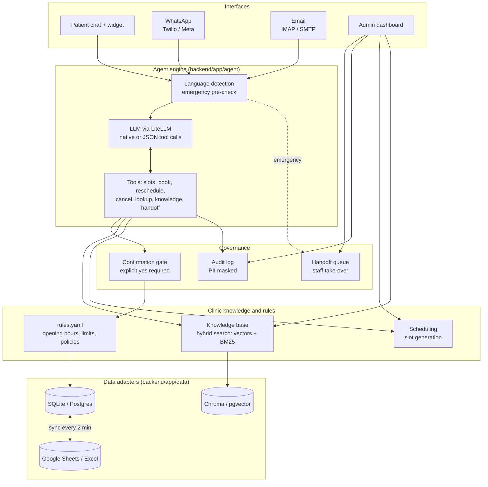

# Clinic Assistant

**A self-hostable, open-source AI front desk for small clinics.** Patients chat on the clinic's website, on
WhatsApp or by email, in English or German. The assistant books, reschedules and cancels appointments, answers
questions from the clinic's own documents (naming the source), and hands anything medical or urgent to staff.
Staff manage everything in an admin dashboard.

> [!WARNING]
> **This is not certified medical software.** It is not a medical device, does not give medical advice, and must
> not be relied on for emergencies. **Anyone who uses it with real patient data is responsible for GDPR
> compliance** (and any other law that applies): a legal basis and privacy notice, a data processing agreement
> with every provider involved (LLM, hosting, WhatsApp, email), data retention, and patients' rights. Run it on
> servers you control, and prefer an LLM provider in the EU, or a local model.

<!-- Demo GIF placeholder: record the patient chat booking an appointment and save it as docs/assets/demo.gif -->
<p align="center"><em>[ demo GIF coming soon: docs/assets/demo.gif ]</em></p>

## What it does

- **Patient chat** that works on phones, an **embeddable website widget**, **WhatsApp** (Twilio or Meta) and **email**.
- **Bookings** against real doctor calendars: services with durations, weekly hours, time off. Double booking is
  impossible, enforced by database constraints.
- **Answers from your documents** (PDF, Word, CSV, web pages), always citing the source. It says "I don't know"
  instead of guessing.
- **Safety in code, not in the prompt:** emergency keywords get a fixed "call 112" reply and an urgent staff task.
  Medical questions are never answered, and nothing is booked or cancelled without the patient's explicit "yes".
- **Admin dashboard:** calendar, conversations with live take-over, handoff queue, knowledge base, audit log and settings.
- **Day-before reminders** through the channel the patient used.
- **Bring your own AI:** OpenAI, Anthropic, OpenRouter, Mistral, Groq, Azure, or a local model with Ollama.
- **Your data where you want it:** SQLite (zero setup), Postgres/Supabase, Google Sheets or Excel.
- **Every action audited**, with personal data masked in logs.

## Quickstart (Docker)

You need [Docker](https://docs.docker.com/get-docker/) and an API key for an AI provider (or [Ollama](docs/ollama.md)).

```bash
git clone https://github.com/satishkumarnirujogi/Business_communication_tool.git && cd Business_communication_tool
cp .env.example .env        # then set LLM_PROVIDER, LLM_MODEL and LLM_API_KEY in .env
docker compose up -d
```

Open **http://localhost:8080** for the patient chat and **http://localhost:8080/admin** for the dashboard. The
first visit to the dashboard opens the setup wizard, which creates your admin account.

The stack runs in **demo mode**: a sample clinic with six doctors, ten services, a few bookings and its documents,
so you can try everything at once (see [Try it](#try-it)). For a real clinic, set `DEMO_MODE=false` in `.env`
**before** the first start, or start from an empty database. Demo mode never overwrites a database that already
has doctors.

Deploying on a server with HTTPS: [docs/deploy-vps.md](docs/deploy-vps.md).

## Architecture



Every channel is an adapter that turns its provider's format into a plain message for the same engine. Every write
runs as a database transaction that re-checks `rules.yaml` and writes its audit row together with the change.
Docker runs three containers: **backend** (FastAPI), **frontend** (nginx serving the web apps and forwarding
`/api` and `/webhooks`) and **chroma** (vector store).

## Configuration reference

Three places, all editable from **Admin → Settings** as well:

| File | What |
|---|---|
| `.env` | Secrets and deployment settings (all documented in [`.env.example`](.env.example)) |
| `config/clinic.yaml` | Clinic name, phone, address, timezone, languages, currency, branding |
| `config/rules.yaml` | Opening hours, closed dates, booking limits, cancellation and reschedule notice, emergency/medical keywords |

Main `.env` settings (defaults in brackets):

| Setting | Meaning |
|---|---|
| `LLM_PROVIDER`, `LLM_MODEL`, `LLM_API_KEY` | The AI model, e.g. `openrouter` + `anthropic/claude-haiku-5.5` ([table](#choosing-an-ai-model)) |
| `LLM_BASE_URL` | Only for Ollama, Azure or self-hosted endpoints |
| `LLM_TOOL_MODE` [`auto`] | `auto`, `native` or `json` (JSON helps small local models) |
| `LLM_TIMEOUT_SECONDS` [60], `LLM_TEMPERATURE` [0.2], `LLM_MAX_TOKENS` [2000] | Tuning |
| `DEMO_MODE` [`false`; `true` in Docker] | Fill an empty database with the demo clinic and documents on startup |
| `DATA_SOURCE` [`sqlite`] | `sqlite`, `postgres`, `excel` or `google_sheets` ([details](#choosing-where-data-lives)) |
| `SQLITE_PATH` [`data/clinic.db`], `DATABASE_URL` | SQLite file / Postgres connection string |
| `EXCEL_PATH`, `GOOGLE_SHEETS_ID`, `GOOGLE_SERVICE_ACCOUNT_FILE`, `SYNC_INTERVAL_SECONDS` [120] | Spreadsheet sources ([guide](docs/google-sheets.md)) |
| `EMBEDDING_PROVIDER` [`local`], `EMBEDDING_MODEL` | Local multilingual model (no key) or any LiteLLM embedding model |
| `KB_VECTOR_STORE` [`auto`], `CHROMA_PATH`, `CHROMA_HOST`, `CHROMA_PORT` | Chroma (embedded or server) or pgvector |
| `KB_MIN_SCORE` [0.30], `KB_ALLOW_PRIVATE_URLS` [`false`] | Retrieval strictness; intranet URL imports |
| `ADMIN_TOKEN` | Break-glass admin key for scripts and recovery |
| `PUBLIC_BASE_URL` | The public https address (needed for WhatsApp webhooks) |
| `WHATSAPP_PROVIDER` [`none`] + `TWILIO_*` or `WHATSAPP_*` | WhatsApp ([guide](docs/whatsapp.md)) |
| `EMAIL_ENABLED` [`false`], `EMAIL_ADDRESS`, `IMAP_*`, `SMTP_*` | Email channel |
| `REMINDERS_ENABLED` [`true`], `REMINDER_SEND_TIME` [10:00], `REMINDER_MIN_HOURS` [3] | Day-before reminders |
| `CONFIG_DIR` [`config/`], `LOG_LEVEL` [`INFO`], `CLINIC_*` | Config folder, logging, override any `clinic.yaml` field |

Invalid settings stop startup with a message that names the setting, for example:

```
Configuration problem in config/clinic.yaml:
  - timezone: 'Mars/Olympus' is not a known timezone. Use a name like 'Europe/Berlin' or 'UTC'.
```

## Guides

- [Deploying to a small VPS](docs/deploy-vps.md) (Docker, HTTPS with Caddy, backups, updates)
- [Using a local model with Ollama](docs/ollama.md) (no patient text leaves your server)
- [Connecting Google Sheets](docs/google-sheets.md)
- [Connecting WhatsApp](docs/whatsapp.md)
- [Contributing](CONTRIBUTING.md)

## Running without Docker

```bash
python -m venv .venv
.venv/bin/pip install -e "backend[dev]"            # Windows: .venv\Scripts\pip ...
cp .env.example .env                                # LLM_* settings; DEMO_MODE=true for the sample clinic
cd frontend && npm install && npm run build && cd ..
cd backend && ../.venv/bin/uvicorn app.main:app     # http://127.0.0.1:8000 and /admin
```

- To load the demo clinic into any store on demand, run `python -m scripts.seed_demo` from `backend/` (it asks
  first, because it replaces all clinic data). The chat widget demo is at http://127.0.0.1:8000/ui/widget-demo.html.
- For UI development, run `npm run dev` in `frontend/` and open http://localhost:5173/ui/admin.html or `/ui/chat.html`.
- To run the checks CI runs, use `ruff check .`, `mypy` and `pytest -q` in `backend/`, and
  `npm run typecheck && npm run build` in `frontend/`. Tests need no database or API key. Set `TEST_DATABASE_URL`
  to also run them against Postgres; that database is wiped.

## Layout

```
backend/            FastAPI app (run commands from here)
  app/
    config.py       all settings: .env + config/clinic.yaml
    llm/            LiteLLM provider, test connection, JSON tool-call fallback
    agent/          engine (tool loop), prompts, tools, language
    data/           DataStore interface; SQLite, Postgres, Excel, Google Sheets stores; demo data
    knowledge/      document parsing, chunking, embeddings, Chroma/pgvector, hybrid search
    scheduling/     slot generation from weekly hours + exceptions
    channels/       channel interface, WhatsApp (Twilio / Meta), email (IMAP/SMTP), router, reminders
    api/            chat, admin, knowledge-base, calendar, channel settings and webhook routes
    rules.py        rules.yaml checks
    audit.py        audit trail (personal data masked)
    privacy.py      masking of emails, phone numbers, birth dates in logs and audit
  tests/  scripts/  static/  Dockerfile
frontend/           React + Vite + TypeScript + Tailwind + shadcn/ui: patient chat, admin dashboard, widget;
                    Dockerfile + nginx.conf
config/             clinic.yaml (profile), rules.yaml (business rules); edit these, no code needed
templates/          clinic_template.xlsx (spreadsheet layout with a README tab)
demo/knowledge/     demo documents (policies, price list, offers, doctors, FAQ in EN + DE)
docs/               guides
data/               local database, uploads, vectors, embedding model (gitignored; a Docker volume)
docker-compose.yml  backend + frontend + chroma
.env                secrets (copy from .env.example; never committed)
```

## Choosing where data lives

Set `DATA_SOURCE` in `.env`:

| `DATA_SOURCE` | Setup | Good for |
|---|---|---|
| `sqlite` (default) | nothing; file at `data/clinic.db` | one server, zero maintenance |
| `postgres` | `DATABASE_URL` (Supabase: session pooler URI) | an existing Postgres/Supabase |
| `excel` | `EXCEL_PATH` → a copy of `templates/clinic_template.xlsx` | staff who live in Excel |
| `google_sheets` | `GOOGLE_SHEETS_ID` + `GOOGLE_SERVICE_ACCOUNT_FILE` ([guide](docs/google-sheets.md)) | shared editing in the browser |

**Spreadsheets are for editing; they are not the booking engine.**
- The assistant copies the sheet into a local SQLite database every 2 minutes (`SYNC_INTERVAL_SECONDS`), and also on demand:
  `POST /api/admin/data/sync`.
- Every booking runs in a SQLite transaction with unique indexes, so double booking is impossible.
- Staff edit doctors, services, weekly `availability` and `exceptions` (time off, extra hours). Bookable slots are
  generated from these.
- New bookings and cancellations are written back to the `patients` and `appointments` tabs a few seconds after they commit.
- Hours changed in the admin calendar are written back to the sheet.
- A bad row, such as a wrong date or an unknown doctor id, is skipped with a readable warning.
- A tab with wrong headers is ignored entirely, so a broken sheet can't wipe the clinic's data.

Load the demo clinic into any store with `python -m scripts.seed_demo --store sqlite|postgres|excel|google_sheets`. Add
`--reset` to recreate the tables after a schema change. Rebuild the template with `--template`.

## Clinic knowledge base

Admins upload PDF, DOCX, TXT, MD or CSV files, or add a web page URL. Each document gets one category:
`policy`, `rules`, `services`, `prices`, `offers`, `doctors`, `faq` or `other`.

```bash
curl -H "X-Admin-Token: <ADMIN_TOKEN>" -F "file=@price-list.pdf" -F "category=prices" http://127.0.0.1:8000/api/admin/knowledge
curl -H "X-Admin-Token: <ADMIN_TOKEN>" -H "Content-Type: application/json" \
     -d '{"url": "https://clinic.example/faq", "category": "faq"}' http://127.0.0.1:8000/api/admin/knowledge/url
```

**Processing** runs in the background, and a document's status goes `processing` → `ready` or `failed`. A failed
document shows a readable error, such as "The PDF is password-protected".
- Text is split into chunks of about 800 tokens with overlap. PDFs keep their page numbers.
- Each chunk is embedded as short passages and stored in ChromaDB (`data/chroma`), or in pgvector when
  `DATA_SOURCE=postgres`. Both sit behind the same interface (`KB_VECTOR_STORE`).
- **Re-uploading a file with the same name replaces its old chunks.** An identical re-upload is skipped.

**Embeddings:**
- The default is a local multilingual model (German + English, about 220 MB, downloaded once on first start, then works
  offline, with no API key).
- `EMBEDDING_PROVIDER=litellm` uses an embedding API instead, e.g. `EMBEDDING_MODEL=openai/text-embedding-3-small`.
- After changing the model, documents are re-indexed automatically at startup.

**Answering:**
- The agent calls `search_clinic_knowledge`, which combines vector similarity with keyword (BM25) ranking.
- Answers that use documents end with `(Source: price-list.csv)`, and `/api/chat` returns the cited files in `sources`.
  The chat page shows them as tags.
- If nothing relevant is found, the assistant says it doesn't have that information and offers to pass the question to
  staff. It is told never to invent prices, policies or doctor details.

Test what the assistant would retrieve:
`POST /api/admin/knowledge/search {"query": "how much is a skin check"}` shows the passages with their scores.
`KB_MIN_SCORE` (default 0.30) tunes how strict retrieval is.

`scripts.seed_demo` uploads the demo documents in `demo/knowledge/`.

## Doctor calendars and services

**Data model:**
- **doctors:** name, specialty, languages, photo URL, bio.
- **services:** name, duration, price, calendar colour, and which doctors offer each one.
- **Weekly availability templates:** e.g. "Dr. Hart, Tuesday 14:00–17:00".
- **Exceptions:** `off` covers holidays, sick days and blocked time, for one doctor or the whole clinic. `extra` covers one-off extra hours.

**Slot generation** (`app/scheduling`) works like this:
- Working time = weekly hours + extra hours, kept within the clinic's opening hours, minus time off.
- That time is cut into a grid of `booking.slot_minutes` (15 by default, in `rules.yaml`) for the whole booking window (30 days).
- The grid refreshes hourly, at startup, after every calendar edit, and after every sheet sync.
- Time off that covers an existing booking never deletes it. The booking is kept, and the API and sheet sync list it so staff
  can rebook the patient.

**Service length:** a booking takes as many consecutive grid cells as the service needs. Durations round up to the grid, so a
20-minute service on a 15-minute grid books 30 minutes. `check_available_slots` with a `service_id` only offers doctors who
provide that service, at start times where the whole visit fits. A unique index on the cells an appointment occupies makes
overlapping bookings impossible, even when they start at different times.

**Admin calendar** (`/admin`):
- Week, month and day views, for one doctor or all doctors. Bookings are coloured by service.
- Working hours show as teal shading, time off as stripes.
- Choose a doctor and drag across the calendar to add weekly hours, one-off extra hours or time off. The whole-clinic option
  closes every doctor.
- Click a booking to see the patient and service, and to cancel it. A staff cancellation skips the 48h rule and is audited
  with a note.
- The side panel lists and deletes weekly hours and exceptions.

Google Calendar two-way sync (optional in the roadmap) is not built yet.

## Patient chat and website widget

The chat at `/` is built for patients and works on phones. It is white and soft teal, uses the Inter font, and shows the
clinic's logo and name from `clinic.yaml`.

- **Live answers:** replies stream in as they are written, with a typing indicator. While the assistant works it shows a
  status, e.g. "Checking availability…".
- **Quick replies:** Book appointment / Opening hours / Services and prices / Cancel or reschedule.
- **Slot buttons:** free times appear as tappable buttons, not plain text.
- **Confirmation:** before booking, moving or cancelling, the summary comes with **Yes, confirm** / **Change something**
  buttons. The server still requires the patient's yes, as described under Safety.
- **Booking card:** confirmed bookings show a card with the doctor, service, time, address and reference, plus
  **Add to calendar**, which downloads an `.ics` file in the browser.
- **Sources:** documents used for an answer appear as small tags under it.
- **Language:** a DE/EN toggle. The assistant answers in the chosen language.
- **Staff replies:** if staff take a conversation over, their messages appear in the chat within a few seconds.

**Embed it on the clinic's website** with one line:

```html
<script src="https://YOUR-ASSISTANT-HOST/widget.js" async
        data-label="Chat with us" data-color="#0f9d94" data-lang="de"></script>
```

This adds a floating chat button that opens the chat in an iframe served by the assistant, so the website's CSS and
scripts can't interfere with it. On phones it opens full screen. Other options: `data-position="left"`.

## Admin dashboard

`/admin`, for signed-in staff:

| Page | What it does |
|---|---|
| **Setup wizard** | Shown on the first visit, until an account exists. It covers clinic details and languages, the AI provider and key (with **Test connection**), the data source, opening hours, and the admin account, then optionally the logo and first documents. It takes about five minutes. |
| **Overview** | Today's appointments, open handoffs (urgent ones flagged), today's conversations, and the share resolved without staff. |
| **Calendar** | Week/month/day views and drag-to-create hours or time off. |
| **Conversations** | Searchable list and full transcript. **Take over** pauses the assistant so you can reply yourself; **Hand back** returns the chat to the assistant. Emergency detection keeps working during a take-over. |
| **Handoff queue** | Tasks the assistant created (callbacks, medical questions, emergencies), each open / in progress / done, with notes and a link to the conversation. |
| **Doctors & services** | Add, edit and hide doctors and services (duration, price, colour, who offers them). |
| **Knowledge base** | Drag-and-drop upload, add a web page, status (processing / ready / failed), delete, and a "try a question" box. |
| **Audit log** | Filter by text, action, decision and dates; expand a row to see its masked inputs and result. |
| **Settings** | AI model (with test), clinic and branding (logo upload, colour), rules (a form over `rules.yaml`: opening hours, closed dates, booking limits, notice periods, safety keywords; comments in the file are kept), users, data source, and your own password. |

**Accounts:**
- **Roles:** `staff` can use the calendar, conversations, handoffs, knowledge (read) and the audit log. `admin` can also
  change settings, users, doctors, services and documents.
- **Passwords:** stored only as scrypt hashes. Sign-in gives a 12-hour session token, and only its hash is stored.
- **Lockout:** five failed sign-ins lock that email or address for 15 minutes.
- **Recovery:** `ADMIN_TOKEN` from `.env` still works as an admin key for scripts and recovery ("Use the admin token
  instead" on the sign-in page).

## WhatsApp, email and reminders

Patients can also reach the assistant on **WhatsApp** and by **email**. All channels share one engine: emergency
detection, confirmation before booking, staff take-over and the audit log work the same everywhere. Each channel
is an adapter in `backend/app/channels/` that turns its provider's format into a plain message and sends text back.

- **WhatsApp:** through Twilio or the Meta WhatsApp Cloud API, using the clinic's own number and token. Webhooks
  are at `/webhooks/whatsapp/twilio` and `/webhooks/whatsapp/meta`, and every request's signature is checked.
  Step-by-step guide: [docs/whatsapp.md](docs/whatsapp.md).
- **Email (optional):** the assistant reads unread mail in a dedicated inbox over IMAP (every 60 s) and replies
  over SMTP in the same thread. Quoted history is ignored, so a reply of just "Yes" confirms a booking.
  Auto-replies, newsletters and bounces are never answered.
- **One conversation per sender:** the same phone number or email address continues the same conversation.
  Staff replies from the Conversations page are delivered to the patient's WhatsApp or email.
- **Reminders the day before:** sent at `REMINDER_SEND_TIME` (default 10:00, clinic time) through the channel the
  patient booked on. WhatsApp uses an approved template when the 24-hour window has closed. Bookings from the web
  chat or by staff are reminded by email, if email is set up; otherwise they are marked *skipped* with the
  reason. A rescheduled appointment gets a new reminder. Failures are retried three times, then become a
  callback task.
- **Spam protection:** provider retries are de-duplicated, and one sender can trigger at most 30 replies an hour.

Configure everything in **Admin → Settings → Channels**, which has a test-message button and the list of upcoming
reminders, or in `.env` (see `.env.example`).

## Choosing an AI model

Set these in `.env`:

| Provider | `LLM_PROVIDER` | `LLM_MODEL` example | `LLM_API_KEY` | `LLM_BASE_URL` |
|---|---|---|---|---|
| OpenRouter | `openrouter` | `anthropic/claude-haiku-5.5` | yes | |
| OpenAI | `openai` | `gpt-4o-mini` | yes | |
| Anthropic | `anthropic` | `claude-haiku-5-5` | yes | |
| Mistral | `mistral` | `mistral-small-latest` | yes | |
| Groq | `groq` | `llama-3.3-70b-versatile` | yes | |
| Azure OpenAI | `azure` | your deployment name | yes | `https://<resource>.openai.azure.com` |
| Ollama (local) | `ollama` | `qwen3` | no | `http://localhost:11434` |

Check the settings without restarting:

```bash
curl -X POST -H "X-Admin-Token: <ADMIN_TOKEN>" http://127.0.0.1:8000/api/admin/llm/test
```

It returns `{"ok": true, "latency_ms": ...}` or a plain-language error, such as "The API key was rejected by openai. Check
LLM_API_KEY." To test settings before saving them (the setup wizard will use this), post a JSON body with any of
`provider`, `model`, `api_key` or `base_url`.

**Tool calls:** `LLM_TOOL_MODE=auto` (the default) uses the model's native tool calling. If the provider rejects tools, it switches
to a JSON mode for that model automatically: the tools are described in the prompt and the model answers in JSON. Set `json` to
force that mode for small local models, or `native` to turn the fallback off. Both modes go through the same rule checks and audit log.

## Safety

These are enforced in code, not left to the model:

| Rule | How |
|---|---|
| **Emergencies** | Keywords in English and German, set in `rules.yaml` (chest pain / Brustschmerzen, can't breathe / Atemnot, heavy bleeding / starke Blutung, ...). The patient gets a fixed "call 112" reply in their language and an **urgent staff task** is created. Any booking in progress is dropped, and the LLM never sees the message. Suicide-related messages get a separate crisis reply with the Telefonseelsorge number. |
| **No medical advice** | Medical keywords (dose, symptoms, Nebenwirkungen, ...) create a staff task, and the model is told to give no advice and offer an appointment instead. The system prompt forbids diagnoses and medication guidance. |
| **Confirm before changing anything** | `book_appointment`, `reschedule_appointment` and `cancel_appointment` first run as a dry run that checks every rule and returns a summary plus a `confirmation_id`. The change only happens when the tool is called again with that id **and** the patient's next message is a clear yes ("yes", "ja", "passt", ...; "yes but at 10" doesn't count). If the details change, a new confirmation is needed. |
| **Rule validation** | Every write is checked against `rules.yaml` inside the same transaction that performs it. |
| **Language** | Each message is detected as German or English (`clinic.yaml` `languages`). The model replies in that language, and fixed texts (emergency, errors) are translated. |
| **Privacy** | Emails, phone numbers and birth dates are masked in the audit log and server log, e.g. `j***@e***.com`, `+** *** ****678`, `born **.**.****`. Appointment dates stay readable. Staff tasks keep the contact details staff need to call back. |
| **Audit** | Every tool call, rule decision, escalation and staff action is logged with timestamp, actor, tool, inputs, decision, result and conversation id. |

## How a message flows

```
patient message
  └─ language detection (de/en) · pending confirmation approved only by a clear "yes"
  └─ escalation pre-check (rules.yaml keywords, EN + DE)
       ├─ urgent/crisis → fixed "call 112" message, urgent staff task, pending action dropped, LLM never called
       └─ medical       → staff task, LLM told "no medical advice, offer an appointment"
  └─ LLM via LiteLLM (native or JSON tool calls, max 8 rounds)
       └─ tool call → validate input → validate rules.yaml → DataStore transaction → audit_log
                                                              └─ Sheets/Excel: written back after commit
```

| Tool | Rules checked |
|---|---|
| `search_clinic_knowledge` | read-only; returns passages + source names, or `found: false` with "don't guess, offer a handoff" |
| `list_services` / `list_doctors` | read-only; services with id, length, price (or "on request"), doctors; doctors with specialty, languages, services |
| `check_available_slots` | search window ≤ 14 days, ≤ 30 days ahead; optional `service_id` → only doctors offering it, only start times where the whole visit fits; opening hours, closed dates, 2h lead time |
| `book_appointment` | every grid cell of the visit exists & is free (row/write lock), doctor offers the service, opening hours, lead time, max days ahead, ≤ 3 upcoming per patient, phone must match an existing patient's email; unique indexes stop any race or overlap |
| `reschedule_appointment` | identity, status = booked, ≥ 48h notice (`reschedule.min_notice_hours`), new time fits the service, doctor offers it, booking rules; same reference; confirmation required |
| `lookup_appointment` | email **and** phone must match; returns `can_cancel_online` / `can_reschedule_online` |
| `cancel_appointment` | identity, status = booked, ≥ 48h notice; confirmation required |
| `create_staff_task` | callback / question / complaint for staff (handoff queue) |
| `escalate_to_human` | creates a staff task (urgent for `urgent`); logged as `escalated` |

Bookings and cancellations write their audit row in the same transaction, so a change can't be committed without its
audit record. Denials and reads are logged separately.

## API

Admin endpoints take `Authorization: Bearer <token>` from `/api/auth/login`, or `X-Admin-Token: <ADMIN_TOKEN>`.
**S** = staff or admin, **A** = admin only.

| Method | Path | Who |
|---|---|---|
| POST | `/api/chat` `{message, session_id?, language?}` | public |
| POST | `/api/chat/stream` (same body; server-sent events `delta`, `reset`, `status`, `done`) | public |
| GET | `/api/chat/{session_id}/messages?after=` (staff replies and notices) | public, by session id |
| GET | `/api/clinic`, `/api/health` | public |
| GET | `/api/setup/status`, `/api/setup/defaults`; POST `/api/setup/test-llm`, `/api/setup/complete` | only until the first account exists |
| POST | `/api/auth/login` `{email, password}`, `/api/auth/logout`, `/api/auth/password`; GET `/api/auth/me` | — |
| GET/POST/PATCH | `/api/admin/users[/{id}]` | A |
| GET | `/api/admin/settings`; PUT `/api/admin/settings/llm`, `/clinic`, `/rules`, `/data-source`; POST `/llm/test`, `/logo` | A |
| GET | `/api/admin/overview` | S |
| GET | `/api/audit?q&action&decision&actor&session_id&since&until&limit&offset` | S |
| GET | `/api/admin/conversations?q&status`, `/api/admin/conversations/{id}` | S |
| POST | `/api/admin/conversations/{id}/takeover`, `/reply {text}`, `/release`, `/close` | S |
| GET/PATCH | `/api/admin/tasks[/{id}]` | S |
| GET | `/api/admin/doctors`, `/api/admin/services` | S |
| POST/PUT/DELETE | `/api/admin/doctors[/{id}]`, `/api/admin/services[/{id}]` (delete = hide) | A |
| GET | `/api/admin/calendar?start&end&doctor_id`, `/api/admin/appointments/{reference}` | S |
| POST/PUT/DELETE | `/api/admin/availability[/{id}]`, `/api/admin/exceptions[/{id}]`; POST `/api/admin/appointments/{ref}/cancel` | S |
| GET/POST | `/api/admin/knowledge` (list / upload), `/knowledge/search` | S / A for upload |
| POST/DELETE | `/api/admin/knowledge/url`, `/knowledge/{id}`, `/knowledge/reindex` | A |
| GET/POST | `/api/admin/data/status`, `/api/admin/data/sync`, `/api/admin/slots/regenerate` | S |
| GET | `/api/admin/channels`; PUT `/api/admin/settings/channels {values}`; POST `/api/admin/channels/test {channel, to}` | A |
| GET | `/api/admin/reminders?days=3` | S |
| POST | `/api/admin/reminders/run` (send what's due now) | A |
| POST | `/webhooks/whatsapp/twilio`, GET/POST `/webhooks/whatsapp/meta` (signature-checked) | provider |

`/api/chat` returns `{session_id, reply, escalation, sources, language, ui, human, message_id}`. `ui` carries
`slots`, `confirm` and `booking` for the chat buttons and card.

## Try it

Demo mode (`DEMO_MODE=true`, the Docker default) and `scripts.seed_demo` create:
- 6 doctors, 10 services (with colours), and weekly hours
- Dr. Mehta off sick one day next week; Dr. Watanabe running an extra Saturday clinic
- about 1,800 15-minute slots over the next 30 days
- 10 patients
- 6 appointments with services, `DEMO0001` to `DEMO0006`

`DEMO0001` belongs to Liam Carter (liam.carter@example.com, +1-555-0111). It is the earliest bookable slot, usually less than
48h away, so it demonstrates the cancellation denial.

Try:
- "How much does a skin check cost?" / "Wie viel kostet die Grippeimpfung im Dezember?" → answer with source
- "Do you offer acupuncture?" → "I don't have that information", offers a handoff
- "Any dermatology slots next week?" → book one as a new patient
- "Look up my appointments, liam.carter@example.com, +1-555-0111" → "cancel DEMO0001"
- "I'd like a skin check next Tuesday afternoon" → times → details → confirmation summary → "yes" → booked
- "Ich möchte meinen Termin <Referenz> auf Mittwoch verschieben" → German reschedule with confirmation
- "Ich habe Brustschmerzen" / "I have chest pain" → 112 message + urgent staff task
- "What dose of ibuprofen should I take?" → no advice, staff task, offer of an appointment
- "Can someone call me back about my invoice?" → staff task

## Notes

- **LiteLLM version:** pinned exactly in `backend/pyproject.toml`, because releases 1.82.7 and 1.82.8 on PyPI were compromised in
  March 2026. Upgrade deliberately. LiteLLM uses its bundled model list and does not download one at startup.
- **Sessions and workers:** conversations are stored in the database, and the assistant rebuilds its context from them
  after a restart. Pending confirmations and the in-memory session cache are per process, so run a single worker process,
  which the sheet sync also expects.
- **Supabase:** tables get row-level security with no policies, so Supabase's public REST API can't read them. The app connects directly.
  pgvector is enabled automatically (`create extension vector`).
- **URL imports:** only public addresses are allowed (no `localhost` or intranet), unless `KB_ALLOW_PRIVATE_URLS=true`.
- **Identity:** there is no real login on the chat page; patients identify themselves with email + phone. Consider
  what that means for your clinic before using real patient data.
- **Not medical software, GDPR:** see the warning at the top. The assistant is a scheduling and information tool,
  and anyone using real patient data is responsible for GDPR compliance.

## License

[MIT](LICENSE). Contributions welcome: see [CONTRIBUTING.md](CONTRIBUTING.md).
